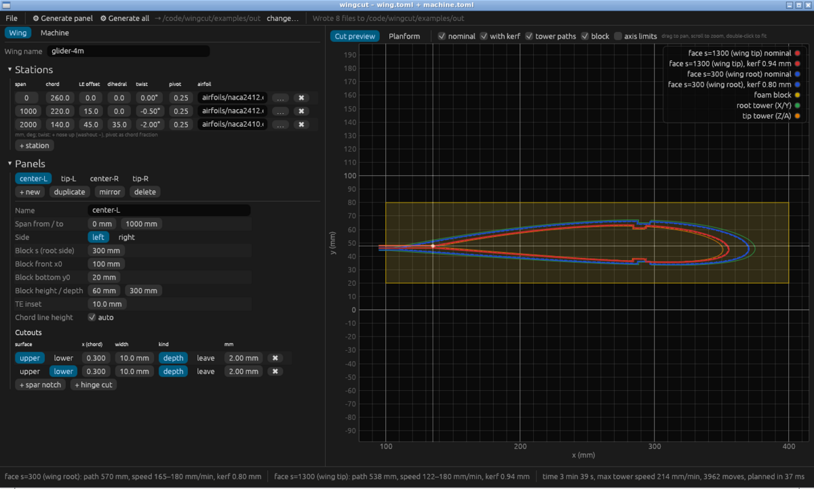
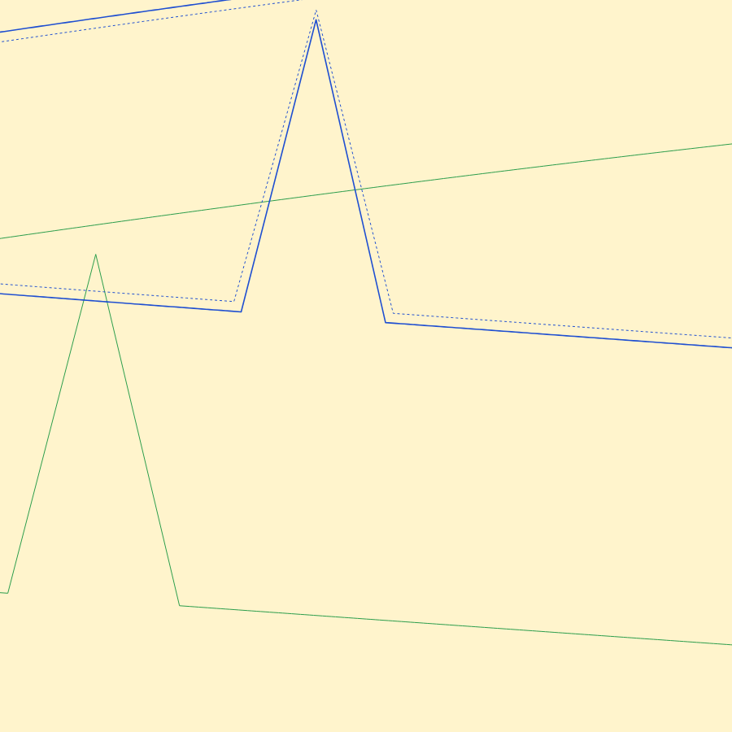

# wingcut

Open-source, Linux-first Rust tool that turns a wing definition (airfoils, chord, sweep, twist, dihedral, panels) into synchronised 4-axis G93 G-code for a DIY CNC hot-wire foam cutter running FluidNC.

Status: **stages 1–4 built**: CLI core, multi-panel wings, a desktop GUI (sheeting, spar notches, slot and V hinge cuts, DXF import) and machine control (FluidNC over USB or Wi-Fi, Riden wire supply). Stage 4 is tested against simulated hardware only; see [docs/hardware-bringup.md](docs/hardware-bringup.md). See [SPEC.md](SPEC.md) for the build brief and [docs/hardware-plan.md](docs/hardware-plan.md) for the machine.

> Not yet validated on a real machine or in devSim (SPEC §9). Check every file before cutting.

## Build

Quickest way to try everything on a Linux desktop: `bash scripts/try-local.sh` (see [docs/try-locally.md](docs/try-locally.md)).

```bash
cargo build --release        # binary: target/release/wingcut
cargo test
```

Dependencies: `serde`, `toml`, `clap`, `clap_complete` (shell completions), `anyhow`. The GUI crate (`gui/`) adds `eframe`, `egui_plot` and `rfd`; the machine crate (`machine/`) adds `serialport` (built without libudev, so Linux needs no extra packages) and `tungstenite`. All were approved by the owner. Polyline offsetting is written in-house (`src/geom.rs`).

## Use

```bash
# all panels of the 4 m example glider -> out/<panel>.gcode + out/<panel>.svg
wingcut gen --machine examples/machine.toml --wing examples/wing.toml -o out/

# one panel
wingcut gen --machine examples/machine.toml --wing examples/wing.toml --panel tip-L

# validate configs and axis limits, write nothing
wingcut check --machine examples/machine.toml --wing examples/wing.toml

# airfoil stats
wingcut info examples/airfoils/naca2412.dat

# shell completions (bash, zsh, fish, elvish, powershell)
wingcut completions bash > ~/.local/share/bash-completion/completions/wingcut
```

`gen` prints a summary per panel on stdout: path length, min/max/average speed and kerf per face, estimated time and max tower speed. Warnings go to stderr. Every panel is planned before anything is written, so a projected point outside the axis limits (an error naming the tower, axis, value and point) means no files are written at all. Files are written via a temporary file and a rename, so an interrupted run never leaves a truncated G-code file behind. Exit codes: 0 ok, 1 error, 2 usage.

The SVG preview shows, in machine coordinates: both face profiles (dashed = nominal, solid = with kerf and lead-in/out), both tower paths, the foam block, and the axis limits.

## GUI

```bash
cargo run --release -p wingcut-gui -- examples/wing.toml   # opens examples/machine.toml next to it
```



- **Left:** forms for the wing (stations, panels, block placement, cutouts) and the machine (travel, feeds, heat, kerf table). Hover a label for help. `…` next to an airfoil picks a `.dat` or `.dxf` file.
- **Centre:** a live preview that re-plans on every edit. It shows both faces (dashed = nominal, solid = with kerf and leads), both tower paths, the block and the axis limits, and turns points outside the limits red. The Planform tab shows the whole half-wing with its panels.
- **Bottom:** the per-face summary, warnings and errors.
- **Top:** File menu (open/save wing and machine, Ctrl+S), and **Generate panel / Generate all**, which write the same G-code and SVG as the CLI. Generate refuses to write anything if a panel breaks the limits.

The GUI edits the same TOML files the CLI reads, so you can switch between them freely. On Linux, file dialogs use the desktop portal (`xdg-desktop-portal`); every path can also be typed in directly. Rendering uses wgpu (Vulkan, Metal or DX12) and falls back to plain OpenGL on machines without those, such as old PCs and VMs.

## Machine control (stage 4)

The GUI's **Control** tab runs the machine without GRBL HotWire:

- **Connect** over USB serial, Wi-Fi (FluidNC's telnet or WebSocket), or the built-in **simulator** to try everything without hardware.
- Machine state, live tower positions (also as a marker on the preview), a wire on/off indicator, Home / Unlock / Reset, and a jog pad for both towers together or one at a time.
- **Run panel**: plans the selected panel and shows pre-flight checks: machine idle, homed, wire parked in front of the block (the program's first move is vertical), work offset, wire current. A **dry run** traces the cut with the wire cold.
- While cutting: progress and time left, **Pause** (feed hold, then the wire switches off; Resume switches it on), **STOP** (hold, then reset: the wire switches off), console. Errors and alarms stop the cut and name the line. Quitting during a cut asks first and stops it.
- **Riden RD60xx** (optional): wingcut sets the voltage limit and the wire current at the start of each cut (a panel can set its own `wire_current`), shows live volts, amps and wire resistance, switches the output off after the cut, and **pauses the cut if the current collapses** (broken wire or lost contact).

Streaming uses grbl character counting (never more than the board's RX buffer in flight). The **E-stop is the primary safety**: if the PC or the cable fails, the board finishes the few moves it has buffered.

Settings live in `machine.toml` (all editable in the GUI):

```toml
[connection]
kind = "serial"            # serial | websocket | telnet | simulator
port = "/dev/ttyUSB0"
baud = 115200
host = "fluidnc.local"     # Wi-Fi
websocket_port = 81
telnet_port = 23
rx_buffer = 127

[riden]
enabled = true
port = "/dev/ttyUSB1"
address = 1
current = 1.8              # A, unless the panel sets wire_current
max_voltage = 45           # V
break_detect = true
break_fraction = 0.5       # pause below 50 % of the set current
```

## Config

See the commented [examples/machine.toml](examples/machine.toml) and [examples/wing.toml](examples/wing.toml). Everything in `machine.toml` has a default matching SPEC §1.

**Placement conventions** (worth reading once):

- `s` runs from the root tower (0) to the tip tower (`tower_spacing`). `block.s_root` is the block face nearest the root tower. The block length must equal the panel span (`to - from`): the block faces are the cut faces.
- The wire enters from the block front at `x0` (low x), at trailing-edge height. The profile's trailing edge sits `inset` (default 10 mm) behind the front, and the LE points towards +x. Park the wire in front of the block (x < `x0`) before you start: the program first moves Y/A to the entry height, then X/Z.
- Vertically, each panel is centred in the block unless you set `block.chord_y` (height of the wing's y = 0 line above the block bottom).
- `side = "left"` puts the wing root on the root-tower face. `side = "right"` mirrors the panel (wing root on the tip-tower face).
- Twist is positive nose-up (washout negative), about `twist_pivot` × chord on the chord line. `le_offset` (sweep) is positive aft. `dihedral_offset` is positive up.
- Axis letters are configurable (`axes = ["X","Y","U","V"]`). Both towers share one set of `limits`.
- `[[panel.cutout]]` cuts in from `surface` at chord fraction `x`. It is the same fraction on both faces, while the sizes are in mm, so a constant-section spar fits the whole panel.
  - Shape: `width` gives a slot with walls perpendicular to the chord; `angle` gives a V-groove (total opening angle in degrees).
  - Size: `depth` below the surface (spar notch), or `leave` = material kept at the opposite surface (hinge). Cut from `lower` for a hinge on top, from `upper` for a hinge underneath.
  - Corners are sync points, and kerf is compensated, so slots come out at the nominal size. A V's tip is reached exactly, so the hinge skin equals `leave` (the wire over-cuts the V's walls slightly near the tip, which a hinge gap allows). A slot narrower than the kerf comes out kerf-wide, and you get a warning.
- `[panel.sheeting]` cuts the core smaller by the skin thickness, so the sheeted wing has the true airfoil:
  - `top` / `bottom`: skin on each surface (mm).
  - `front`: skin over the front zone, both surfaces and round the nose (e.g. a thicker D-box), up to `front_to` (chord fraction, default 0.30). The change from `front` to `top`/`bottom` is a smooth S-curve a few mm long, because a round wire can't follow a sharp inside corner.
  - `le_cap`: cut the core's nose off flat at this chord fraction, for a solid balsa LE block that you glue on and sand to shape (0 = off: the skin wraps the nose).
  - `te_stock`: cut the core's tail off flat at this chord fraction, for a balsa TE strip (1 = off: the core runs to the TE, and `te_min_thickness` keeps it from getting too thin where the skins meet).
  - Slot depths and hinge skins are measured from the core surface.
- An airfoil can be a `.dat` (Selig or Lednicer) or a `.dxf` (a polyline or line outline; arcs and spline control points are not supported).

## How it works

Per panel (SPEC §4):

1. **Parse** Selig or Lednicer `.dat`. A smooth parametric spline goes through the points. The LE is the point farthest from the TE midpoint. The section is normalised to chord 1 with the LE at (0,0); rotated, scaled, reversed and open-TE files all work.
2. **Resample** both surfaces at the same x stations. The stations use LE-clustered cosine spacing, `x = 1 − cos(π/2 · i/(n−1))`. Index *i* is a sync point on every section of the wing. The point count is chosen so that no segment exceeds `max_segment` (0.2 mm) at the largest chord. Full cosine spacing would also cluster points at the TE, giving 10⁻⁴ mm segments that add noise and starve the G-code stream exactly where the wire must not stall.
3. **Sections** come from the wing's span stations by linear interpolation: chord, offsets, twist and a point-by-point blend of the two airfoils. Then the TE is thickened to `te_min_thickness`, the section is twisted about the pivot, and sweep/dihedral are added. Equal span positions give bit-identical sections, so neighbouring panels match at their joint (tested).
4. **Kerf**: each face is offset outward by kerf/2. The kerf comes from the `kerf` table at that face's *average* speed, so the slower face gets more. The offset keeps exactly one point per input point (miter joins with a limit; tight concave loops are collapsed, not removed), so the root/tip sync is never broken.
5. **Cut path**: lead-in from in front of the block at the upper-TE height, then upper surface TE → LE → lower surface → TE, then lead-out at the lower-TE height. It is one connected line, so the top and bottom beds stay whole. There is an optional LE dwell.
6. **Projection** to the towers along the wire line, then a limit check on every point.
7. **G93 timing**: each segment's time is the longer of the two face segments divided by `feed_cut`, so the faster face cuts at exactly `feed_cut`. Wire-off moves are G94 at `feed_rapid`. The program ends with G94, `M5`, park, `M2`. Numbers have 3 decimals and no exponents.



**Known limitations**: the wire cuts a ruled surface, so a station *inside* a panel is not reproduced (you get a warning; split the panel there). Kerf is per face, not per segment.

## Development

```bash
cargo fmt --check && cargo clippy --workspace --all-targets -- -D warnings && cargo test --workspace
```

CI runs the same checks on Linux, macOS and Windows. The tests cover every SPEC §8 requirement, config validation (including `nan`/`inf`, which TOML accepts), CLI behaviour, and a randomised sweep of 40 wing shapes. The sweep checks the invariants: sync kept, the faster face at `feed_cut`, kerf on the outside, and no self-intersections. For library use, see the example in `src/lib.rs`. Limit failures carry a typed `cut::LimitError` with every offending point.

## Licence

MIT, see [LICENSE](LICENSE). The sample NACA airfoils come from the UIUC Airfoil Coordinates Database; see [examples/airfoils/SOURCES.md](examples/airfoils/SOURCES.md).
