# wingcut user guide

wingcut turns a wing design into the G-code that drives a 4-axis hot-wire foam cutter: two towers holding a hot wire, each moving the wire end up/down and front/back. This guide explains every part of the program and every value you can set. No prior hot-wire experience is assumed.

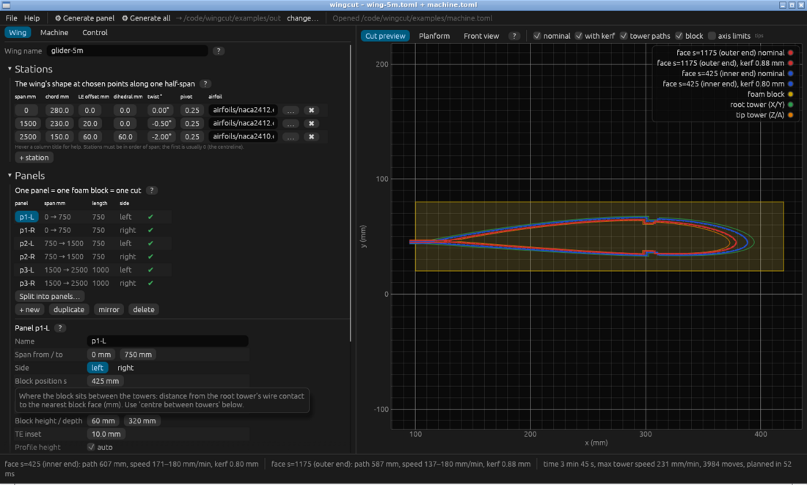

**Contents**

1. [How a wing gets cut](#how-a-wing-gets-cut): the ideas you need first
2. [Quick start](#quick-start)
3. [Worked example: a 5 m wing](#worked-example-a-5-m-wing)
4. The screen: [top bar](#top-bar), [Wing tab](#wing-tab), [Machine tab](#machine-tab), [Control tab](#control-tab), [views](#views), [bottom bar](#bottom-bar)
5. [Signs and directions](#signs-and-directions): what + and − mean for every value
6. [Warnings and errors](#warnings-and-errors)
7. [Files](#files) and [glossary](#glossary)

Hover any label in the program for a short explanation; the small **?** buttons open this guide at the matching section.

---

## How a wing gets cut

**The machine.** A thin nichrome wire is stretched between two towers about 1.6 m apart. Current heats it to a few hundred degrees, and it melts its way through polystyrene foam. Each tower moves its end of the wire in two directions: **x**, front–back (towards/away from you), and **y**, up–down. The *root tower* is on one side (axes X and Y), the *tip tower* on the other (axes Z and A).

```
      root tower (X/Y)                                  tip tower (Z/A)
    ┌──────────┐    hot wire                         ┌──────────┐
    │   ▲ y    ●━━━━━━━━━━━━━━━━━━━━━━━━━━━━━━━━━━━━━●          │
    │   └─▶ x  │          ┌──────────────────┐        │          │
    └──────────┘          │   foam block     │        └──────────┘
   s = 0                  └──────────────────┘                s = 1600
                    ◀── s: position along the wire ──▶
```

**Why panels.** Your wing is longer than the space between the towers, and foam comes in blocks of limited length. So the wing is cut in **panels**: one panel is one foam block, cut in one go. A 4 m wing is typically 4 panels (2 per side), a 5 m wing 4–6.

**How one panel is cut.** The wire can only make straight lines, so each panel is a *ruled surface*: the shape at one end of the block (one airfoil, at one size and angle) blends in a straight line to the shape at the other end. The two towers move together so the wire always touches matching points of both end shapes (*sync points*), and both ends finish at the same moment (wingcut uses G93 *inverse-time* G-code for that). Because the towers stand outside the block, each tower must move along a slightly bigger or smaller path than the foam face next to it; wingcut computes this *projection*.

**The words for a wing** (seen from above, one half):

```
   centreline                                      tip
   span 0 ─────────────────────────────────────▶ span 2500
   ┌──────────────────────────────────────────┐   ← leading edge (LE), the rounded front
   │ root                 chord               │
   │ chord                  ▼                 │ tip chord
   └──────────────────────────────────────────┘   ← trailing edge (TE), the thin back
```

- **Span**: distance from the centre of the wing outwards (mm). wingcut always describes **one half** (0 → half-span) and makes left and right panels from it.
- **Chord**: the airfoil's length, front to back (mm).
- **Station**: a place along the span where you say exactly what the wing looks like (chord, airfoil, position, twist). Between two stations the wing blends in a straight line.
- **Sweep, dihedral, twist**: where the section sits (further back, higher) and how it is rotated. See [Stations](#stations).
- **Kerf**: the width of foam the hot wire melts away (about 1 mm). wingcut moves the wire half a kerf outside the shape so the part comes out the right size. Slower wire = more melting = more kerf.

**Your workflow:** describe the wing (stations) → split it into panels → place each block on the machine → check the previews → generate the G-code → cut, one panel at a time.

---

## Quick start

1. **Open a wing.** *File ▸ Open wing…* and pick `examples/wing.toml` (4 m) or `examples/wing-5m.toml` (5 m). The `machine.toml` in the same folder opens with it. Or *File ▸ New wing* to start empty.
2. **Describe the wing** in the [Stations](#stations) table: at least the root (span 0) and the tip, each with a chord and an airfoil file.
3. **Make the panels:** in [Panels](#panels), press [Split into panels…](#split-into-panels) and accept. Each block is centred between the towers.
4. **Look** at the [Planform and Front view](#views) to check the whole wing, then click each panel and check its **Cut preview**. Every panel should show ✔ in the panel table; fix anything marked ⚠.
5. **Set your machine** once in the [Machine tab](#machine-tab): tower spacing, travel, cutting speed, kerf.
6. **Generate all** (top bar) writes one `.gcode` and one `.svg` per panel. Or run the cut directly from the [Control tab](#control-tab).
7. **Save** (Ctrl+S) the wing and the machine settings.

---

## Worked example: a 5 m wing

A 5 m glider wing is 2500 mm per half. The machine has 1600 mm between the towers, and the longest foam block we want to handle is 1250 mm. That leaves at least 175 mm at each end for clamps and for the wire to run outside the block.

**1. Stations.** We describe one half with three stations (this is `examples/wing-5m.toml`):

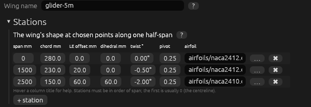

| span | chord | LE offset | dihedral | twist | airfoil | why here |
|---|---|---|---|---|---|---|
| 0 | 280 | 0 | 0 | 0° | NACA 2412 | the wing root, at the centreline |
| 1500 | 230 | 20 | 0 | −0.5° | NACA 2412 | where the aileron starts and the taper changes |
| 2500 | 150 | 60 | 60 | −2° | NACA 2410 | the tip: swept back 60 mm, raised 60 mm (polyhedral), 2° washout |

Put a station everywhere the wing *changes how it changes*: a kink in the leading or trailing edge, a change of airfoil, a dihedral break. A straight taper needs no extra stations.

**2. Panels.** *Split into panels…* with **longest panel 1250 mm**, **split at the stations**, **both** halves:

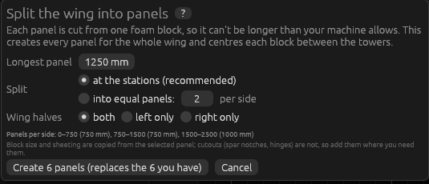

- 0 → 1500 is longer than 1250, so it is divided into two equal panels: 0–750 and 750–1500.
- 1500 → 2500 is 1000 mm: one panel.
- Both halves: **6 panels**, named `p1-L`, `p1-R`, `p2-L`, `p2-R`, `p3-L`, `p3-R` from the centre outwards.

Splitting *at the stations* matters: the wire can only cut straight blends, so a station inside a panel would be smoothed away (the panel table then shows ⚠).

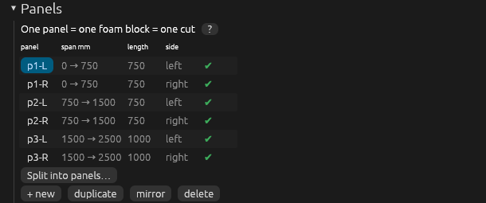

**3. Blocks.** Each block is centred between the towers: a 750 mm panel starts at s = (1600 − 750) / 2 = 425, a 1000 mm panel at 300. The outer panels rise 60 mm from end to end (the polyhedral), so their block must be taller: 110 mm instead of 60 mm. Use the [Front view](#views) to see this.

**4. Per-panel extras.** Inner panels get two spar-cap slots (10 × 2 mm, top and bottom, at 30 % of the chord); outer panels get a V-groove hinge for the aileron (cut from below at 75 %, 0.5 mm of foam left on top). All panels get a D-box skin: 1.5 mm over the front 30 %, 0.6 mm behind.

**5. Check.** The Planform shows the whole 5 m wing with the selected panel highlighted; click any panel to select it.

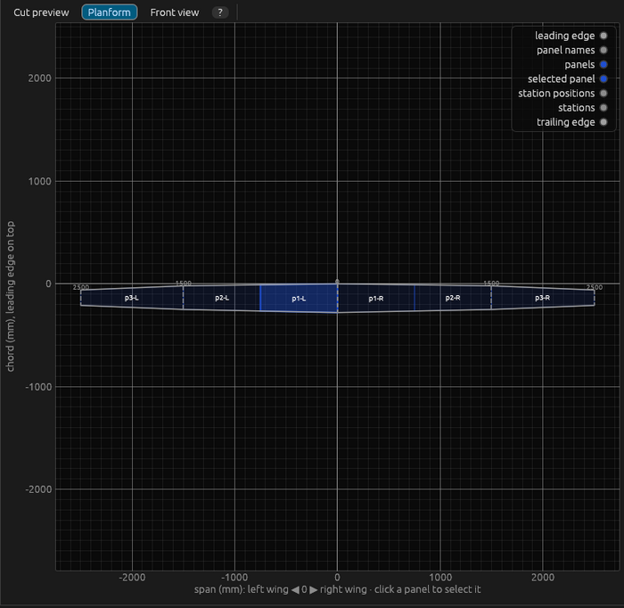

**6. Cut.** *Generate all* writes `p1-L.gcode` … `p3-R.gcode` (about 3½ minutes of cutting each). Write the panel name on each block, and keep left and right apart: they are mirror images and are not interchangeable.

**Other ways to split the same wing:** with 1000 mm blocks you'd get 0–750, 750–1500, 1500–2500 too (1500 is still too long for one block, 1000 is exactly the limit). With *equal panels: 2 per side* you'd get 0–1250 and 1250–2500, but then the station at 1500 sits inside a panel and its kink is lost (⚠). Add a station at 1250 instead if you want that layout.

---

## Top bar


- **File** ▸ *New wing*, *Open wing…*, *Save wing* (Ctrl+S saves the wing and, if changed, the machine), *Save wing as…*, *Open machine…*, *Save machine*, *Save machine as…*, *Quit*. A `*` in the window title means unsaved changes; quitting or opening another wing asks before throwing them away.
- **Help**: this guide, the quick start, this example, the sign conventions, warnings, the hardware checklist.
- **⚙ Generate panel** writes the G-code and SVG preview of the selected panel; **⚙ Generate all** does every panel. Nothing is written if any panel has an error (e.g. outside the machine's travel).
- **→ folder** shows where files go (`out/` next to the wing file); **change…** picks another folder.
- The grey text on the right is the last message (opened, saved, written, or an error in red).

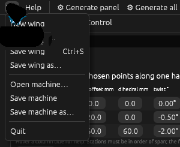 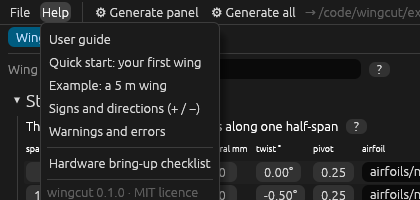

---

## Wing tab

The left side has three tabs: **Wing** (the shape and the panels), **Machine** (your cutter) and **Control** (running the machine). **Wing name** is written into each G-code file's header.

### Stations


Each row describes the wing at one point along the half-span. Rows are kept in order of span. Between two stations every value changes in a straight line.

| column | what it is | unit | + / − | what it changes |
|---|---|---|---|---|
| **span** | distance from the wing's centreline | mm | always ≥ 0 | where this description applies. The first station is usually 0, the last is the tip (half the wingspan). |
| **chord** | airfoil length, LE to TE | mm | > 0 | the size of the section. |
| **LE offset** | how far back the leading edge sits (sweep) | mm | + = further back, − = further forward | the planform: a growing LE offset sweeps the wing back. Only the difference between stations matters. |
| **dihedral** | how high the section sits | mm | + = up, − = down | the front view. A panel whose two ends have different values is cut slanted, which gives dihedral/polyhedral when panels are joined flat. 60 mm over 1000 mm ≈ 3.4°. |
| **twist** | rotation of the section | degrees | + = nose up, − = nose down (*washout*) | the angle of attack along the span. Gliders usually have 1–3° washout at the tip. |
| **pivot** | the point the twist turns around | fraction of chord | 0 = LE, 1 = TE | where the section stays put when twisted. 0.25 (quarter chord) is usual. |
| **airfoil** | the profile file | `.dat` or `.dxf` | – | the shape. Type a path or press **…**. Paths are relative to the wing file. |

- **Airfoil files:** `.dat` files in Selig or Lednicer format (the UIUC Airfoil Database and airfoiltools.com have thousands), or a `.dxf` drawing of the profile as a polyline or lines. Two stations with different airfoils blend point by point.
- **✖** removes a station; **+ station** adds one 500 mm further out, copying the last one.

### Panels


A panel is the part of the wing cut from one foam block.

| column | meaning |
|---|---|
| **panel** | its name (also the output file name). Click to select; the previews and the settings below show the selected panel. |
| **span mm** | where it starts and ends along the half-span. |
| **length** | its length, which is also the block's length. |
| **side** | left or right wing half. |
| ✔ / ⚠ | ⚠ when something is wrong; hover for the reason: longer than the tower spacing, block outside the towers, a station inside the panel, or (for the selected panel) points outside the machine's travel or a planning error. |

Buttons: **Split into panels…** (below), **+ new** (one panel over the whole wing), **duplicate**, **mirror** (a copy for the other side: `p1-L` becomes `p1-R`), **delete**.

### Split into panels


Creates all panels for the whole wing in one step, replacing the existing ones.

- **Longest panel**: the longest block you can cut, in mm. Less than the tower spacing (leave room at both ends), and no longer than your foam. The default is the tower spacing minus 100 mm, at most 1250.
- **Split at the stations (recommended)**: a panel boundary at every station; intervals longer than the maximum are divided equally. No station ends up inside a panel.
- **Into equal panels: N per side**: N equal panels (more if the maximum length requires). Stations may then fall inside panels (⚠).
- **Wing halves**: both, left only, or right only.
- Block size, placement settings and sheeting are copied from the selected panel. Cutouts are not (a spar or hinge usually belongs to specific panels), and each block is centred between the towers.

### Panel and block settings

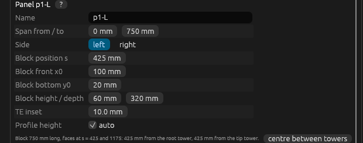

| field | what it is | notes |
|---|---|---|
| **Name** | panel and file name | letters, digits, `-`, `_`, `.` |
| **Span from / to** | panel ends along the half-span, mm | must lie between the first and last station; `to` > `from`. |
| **Side** | **left** or **right** wing half | *left*: the panel's inner end (towards the fuselage) is on the root-tower side of the block. *right*: mirrored, the inner end is on the tip-tower side. Left and right panels are mirror images. |
| **Block position s** | distance from the root tower's wire contact to the nearest block face, mm | the block occupies s … s + length. It must lie between the towers. **centre between towers** sets it automatically. |
| **Block front x0** | machine x of the block's front face (the side facing you), mm | the wire starts in front of it and enters here. |
| **Block bottom y0** | machine height of the block's underside, mm | usually the height of your table or spacers. |
| **Block height / depth** | block height (y) and depth front–back (x), mm | must hold the profile at both ends, including dihedral rise and twist. The preview warns if the profile doesn't fit. |
| **TE inset** | gap from the block front to the nearest trailing edge, mm | the trailing edge faces you, the leading edge points away. |
| **Profile height** | height of the wing's reference line (y = 0) above the block bottom | **auto** centres the profiles vertically in the block. |

The line below the grid shows the block length and how far each face is from each tower.

**Placement on the machine** (looking along the wire):

```
        y ▲            block depth
          │      ┌────────────────────────┐
          │      │  TE ═══════════ LE     │  ← profile (TE faces you)
  block   │      │  ◀ TE inset            │  block height
  bottom y0 ─────└────────────────────────┘
          │      ▲ x0 (block front)                  x ▶ (away from you)
```

### Sheeting

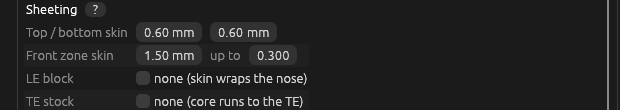

If you cover the foam core with a skin (balsa, obechi, glass), the core must be cut smaller by the skin thickness so the finished wing has the true airfoil. All values are per panel.

- **Top / bottom skin** (mm): skin on the upper and lower surface, behind the front zone. 0 = none.
- **Front zone skin** (mm) **up to** (fraction of chord): the skin over the front part of the wing, top, bottom and around the nose, up to e.g. 0.30 = 30 % of the chord. Use it for a thicker *D-box* skin around the leading edge, or 0 for no skin there. The change from the front skin to the top/bottom skin is a smooth S-curve a few mm long (a sharp step can't be cut cleanly by a round wire).
- **LE block** (*none*, or **at** a chord fraction): cut the core's nose off flat there and glue on a solid balsa block, sanded to shape afterwards. More durable for landings. Off: the skin wraps around the foam nose.
- **TE stock** (*none*, or **at** a chord fraction): cut the core's tail off flat there and glue on a balsa trailing-edge strip. Off: the core runs to the trailing edge, where the top and bottom skins meet; the machine's *TE min thickness* keeps the foam from getting too thin.

Spar-slot depths and hinge skins are measured from the core surface, under the skin.

### Cutouts

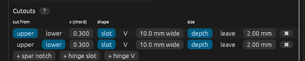
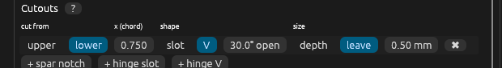

Slots and grooves cut into the core during the same cut.

| field | meaning |
|---|---|
| **cut from** | the surface the cut comes in from: **upper** or **lower**. For a hinge, the hinge itself is on the *other* surface: cut from *lower* for a hinge on top (usual for ailerons), from *upper* for a hinge underneath. |
| **x (chord)** | position of the slot centre or V tip, as a fraction of the chord: 0 = LE, 1 = TE. The same fraction is used at both ends of the panel, so the slot follows the taper. |
| **shape** | **slot**: rectangular, with walls at right angles to the chord. **V**: a V-groove. |
| width / angle | slot: **width** in mm (the same at both ends, so a straight spar fits). V: total **opening angle** in degrees; the throw is roughly ± half of it. |
| **depth** / **leave** | **depth**: how deep the slot goes below the cut surface, at its centre (spar notch). **leave**: how much foam stays at the opposite surface (hinge skin, e.g. 0.5 mm). |

Presets: **+ spar notch** (upper, 30 %, 10 × 2 mm), **+ hinge slot** (from below, 75 %, 1.5 mm wide, 0.5 mm left), **+ hinge V** (from below, 75 %, 30°, 0.5 mm left).

Kerf is compensated, so slots come out at the size you enter. A slot narrower than the kerf comes out kerf-wide (you get a warning). The wire reaches the tip of a V exactly, so the hinge skin equals *leave*.

---

## Machine tab

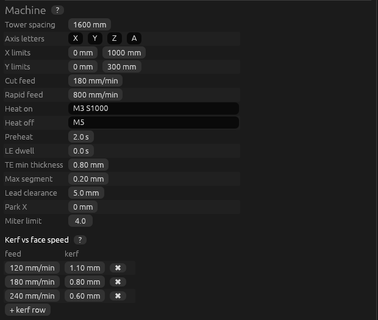

Your cutter, set once and saved in `machine.toml`.

| field | what it is | typical |
|---|---|---|
| **Tower spacing** | distance between the wire contacts of the two towers, mm | 1600 |
| **Axis letters** | the controller's letters for root x, root y, tip x, tip y | X Y Z A (or X Y U V) |
| **X limits** | front–back travel of both towers (min, max), mm. Every point of every cut is checked. | 0 … 1000 |
| **Y limits** | up–down travel (min, max), mm | 0 … 300 |
| **Cut feed** | cutting speed of the faster block face, mm/min. The smaller face moves slower in proportion (that is what keeps both ends in sync). | 120–240 |
| **Rapid feed** | speed of moves with the wire cold, mm/min | 800 |
| **Heat on / off** | the commands that switch the wire on and off. The amount of heat is set on the wire's power supply (amps). | `M3 S1000` / `M5` |
| **Preheat** | wait after switching the wire on, before entering the foam, s | 2 |
| **LE dwell** | optional pause at the leading edge, s | 0 |
| **TE min thickness** | the thinnest the trailing edge may get; thinner foam melts away | 0.8 mm |
| **Max segment** | longest straight step along the profile. Smaller = smoother but longer G-code. | 0.2 mm |
| **Lead clearance** | how far in front of the block the wire starts and ends | 5 mm |
| **Park X** | where both towers go front–back after the cut (the wire stays at its height) | 0 |
| **Miter limit** | how far kerf compensation may reach at sharp corners, × half the kerf. Rarely needs changing. | 4 |

### Kerf table

How much foam the wire melts away, for a few wire speeds. wingcut interpolates between rows, and uses the first/last value outside the table. Each block face gets the kerf for *its own* average speed, so the slower (smaller) end gets more.

**Calibrating:** with your wire current set, measure a 50 mm wide strip of foam (W), cut it in two at one feed, and measure both halves (a, b): kerf = W − a − b. Do it at three feeds (e.g. 120, 180, 240 mm/min) and enter them. Recalibrate for each foam type and whenever you change the current.

---

## Views

The right side shows three views. **Drag** to pan, **scroll** to zoom, **double-click** to fit everything.

### Cut preview

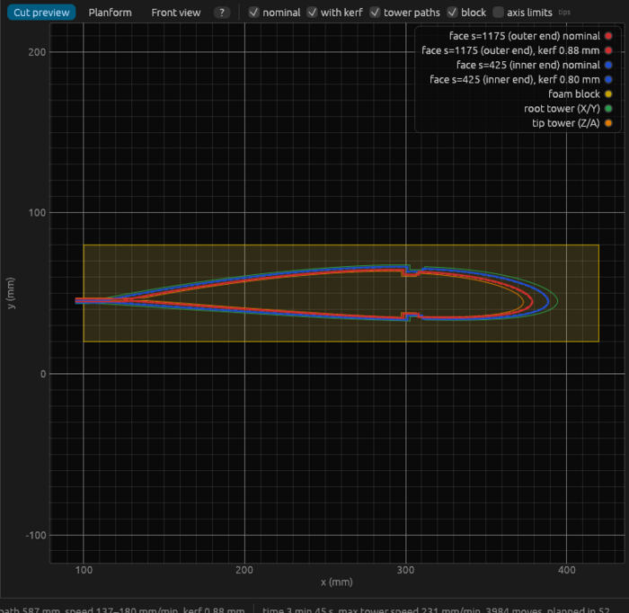

The selected panel as the machine will cut it, looking along the wire. x runs to the right (away from you), y up.

| colour | what it is |
|---|---|
| blue | the block face at the panel's **inner end** (towards the fuselage). Dashed = the exact shape; solid = where the wire goes (half a kerf outside, plus the lead-in and lead-out lines on the left). |
| red | the face at the panel's **outer end**, same styles. |
| green / orange | the paths of the **root tower** (X/Y) and **tip tower** (Z/A). They are bigger or smaller than the faces because the towers stand outside the block. |
| yellow | the foam block. |
| grey dashed | the machine's travel (*axis limits*); switched on automatically when something is outside. |
| red dots | points outside the machine's travel. |
| pink | the wire right now (when connected). |

Tick boxes above the plot hide or show each layer; clicking a legend entry hides it too.

### Planform


The whole wing from above: left half to the left of 0, right half to the right, leading edge on top. Panels are shaded, the selected panel darker; the dashed lines are stations, labelled with their span. **Click a panel to select it.**

### Front view

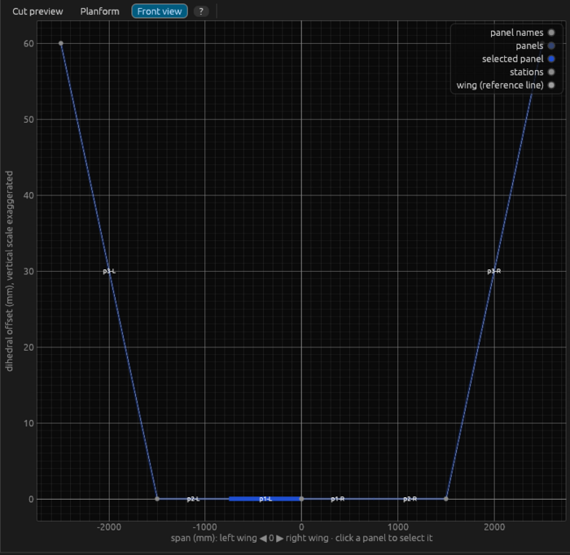

The whole wing from the front: the dihedral offset along the span (the vertical scale is exaggerated). Thick lines are panels, the selected one highlighted. Click to select.

---

## Bottom bar

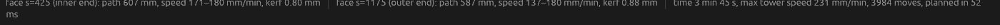

The selected panel's numbers: for each face, the wire's path length, its speed range, and the kerf used; then the cut time, the fastest tower speed, the number of moves, and how long planning took. Warnings appear below in yellow, errors in red.

---

## Control tab

Runs the machine directly, without another program. Without hardware, choose **Simulator** to try everything. The **E-stop on the machine is always the primary safety.**

### Connection

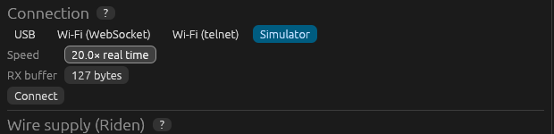

- **USB**: the board's serial port (e.g. `/dev/ttyUSB0` on Linux, `COM3` on Windows) and **Baud** (115200 for FluidNC). ⟳ refreshes the list. On Linux your user must be in the `dialout` group.
- **Wi-Fi (WebSocket)** / **Wi-Fi (telnet)**: the board's **Host** (`fluidnc.local` or its IP) and **Port** (81 for WebSocket, 23 for telnet).
- **Simulator**: a simulated board; **Speed** runs it faster than real time.
- **RX buffer**: how many bytes wingcut keeps waiting in the board while cutting. 127 is safe; don't raise it unless you know your board's buffer.

### Wire supply (Riden)

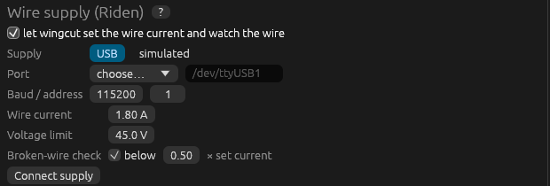

Optional, for a Riden RD6006 (or RD6012/6018/6024) power supply connected by USB. Untick to set the current by hand on the supply.

- **Supply**: **USB** (port, **Baud / address** as set in the supply's menu) or **simulated**.
- **Wire current** (A): set on the supply at the start of every cut, unless the panel has its own `wire_current`.
- **Voltage limit** (V): the most the supply may push; normal running stays well below.
- **Broken-wire check** **below** N × set current: if the current collapses while the wire should be on, the cut pauses and the wire switches off. A snapped wire or a loose clamp is then caught at once.
- **Connect supply** shows the model and the live volts, amps and wire resistance (Ω), and whether the output is on. **Apply current** sends the values now; **Output off** switches the output off. In simulation, **Break the wire** tests the check.

### Machine state

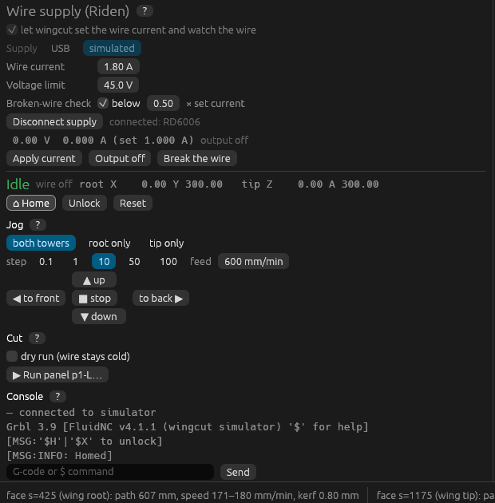

- The **state**: *Idle* (green, ready), *Run*, *Jog*, *Home* (blue), *Hold* (yellow, paused), *Alarm* (red: needs homing or unlocking).
- **wire ON / wire off**: what the board reports.
- **root X Y / tip Z A**: the towers' positions in mm. They also show as a pink line on the cut preview.
- **⌂ Home** finds the machine's zero (`$H`). **Unlock** clears an alarm without homing (`$X`; positions may be wrong). **Reset** stops everything at once and switches the wire off.

### Jog

Moves the wire by hand: **both towers** together, **root only** or **tip only**; a **step** (0.1–100 mm) and a **feed**. **◀ to front** moves towards you (−x), **to back ▶** away (+x), **▲ up** / **▼ down** (±y); **■ stop** cancels a jog.

### Running a cut

1. Home the machine, place and weigh down the block exactly where the panel settings say, and jog the wire **in front of the block** (towards you).
2. Select the panel and press **▶ Run panel …**. Tick **dry run** first to trace the cut with the wire cold.
3. Read the **Before cutting** checks:

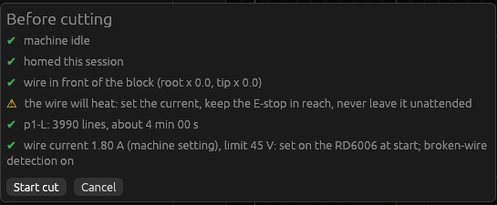

   - *machine idle*, *homed this session*, *wire in front of the block* (the first move is straight up or down, so the wire must not be above or inside the foam), the work offset, the wire current, lines and time. A red ✖ blocks the start; a yellow ⚠ is a reminder.

   Here the start is blocked because the wire is still over the block after an earlier cut:

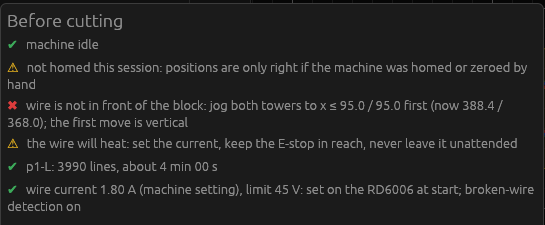
4. **Start cut**. The progress bar shows the line and the time left; the pink line on the preview follows the wire.

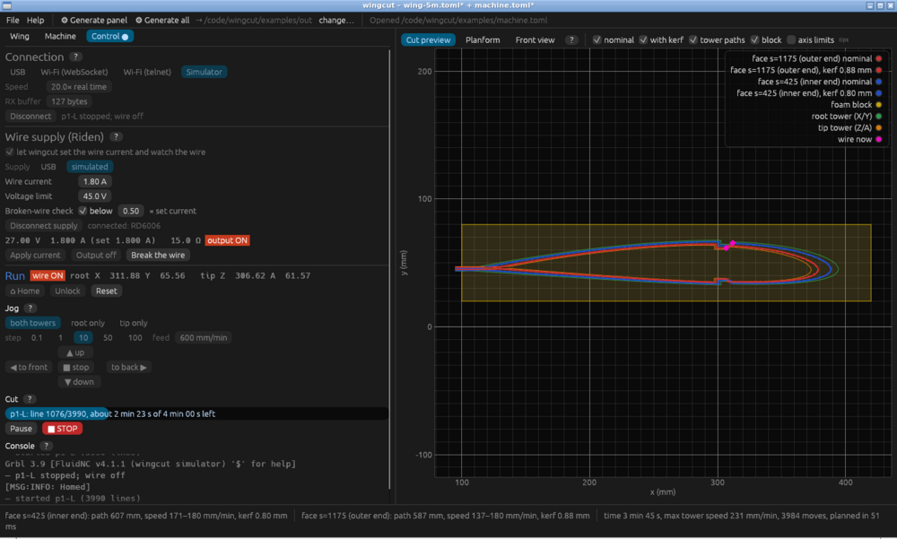

- **Pause** stops the motion, then switches the wire off. **▶ Resume** switches it on and continues.
- **■ STOP** stops and resets the board, which also switches the wire off. The block is usually spoiled.
- If the board reports an error or alarm, the cut stops and the message names the G-code line.
- With the broken-wire check on, a broken wire pauses the cut by itself:

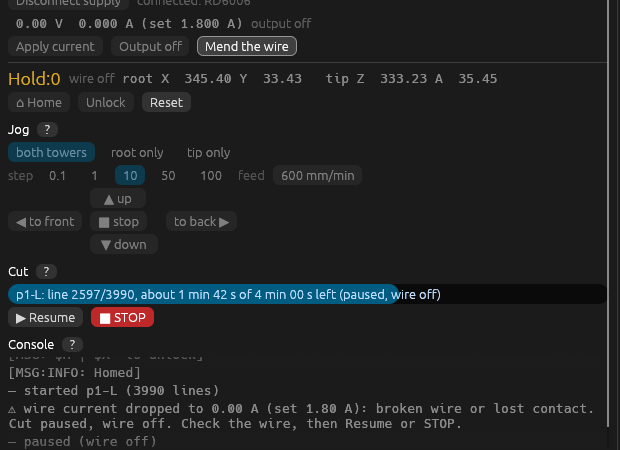

- Quitting during a cut asks first and stops it. If the cable or PC fails, the board finishes the few moves it has buffered: keep the E-stop in reach.

### Console

Everything the board says (start-up message, homing, alarms), and wingcut's own notes. Type a G-code or `$` command and press **Send** (not during a cut). Useful: `$H` home, `$X` unlock, `M5` wire off, `$$` show the board's settings.

---

## Signs and directions

| value | + means | − means | zero / range |
|---|---|---|---|
| station **span** | outwards from the centreline | – | 0 = centreline |
| **LE offset** | leading edge further back (swept back) | further forward | only differences matter |
| **dihedral** offset | section higher | lower | only differences matter |
| **twist** | nose up | nose down (washout) | 0 = no twist |
| twist **pivot** | – | – | 0 = LE … 1 = TE |
| machine **x** (X, Z) | away from you (*to back*) | towards you (*to front*) | limits in the Machine tab |
| machine **y** (Y, A) | up | down | limits in the Machine tab |
| **s** (block position) | towards the tip tower | – | 0 = root tower wire contact |
| Planform / Front view x | right wing half | left wing half | 0 = centreline |
| cutout **x** | – | – | 0 = LE … 1 = TE |
| depth, leave, width, skins | always positive | – | mm |

---

## Warnings and errors

Example: the outer panel's block set 40 mm too low. The wire would have to go below the machine's travel, so those points show red, the axis limits appear, the panel gets ⚠, and the bottom bar explains it; nothing can be generated until it's fixed.

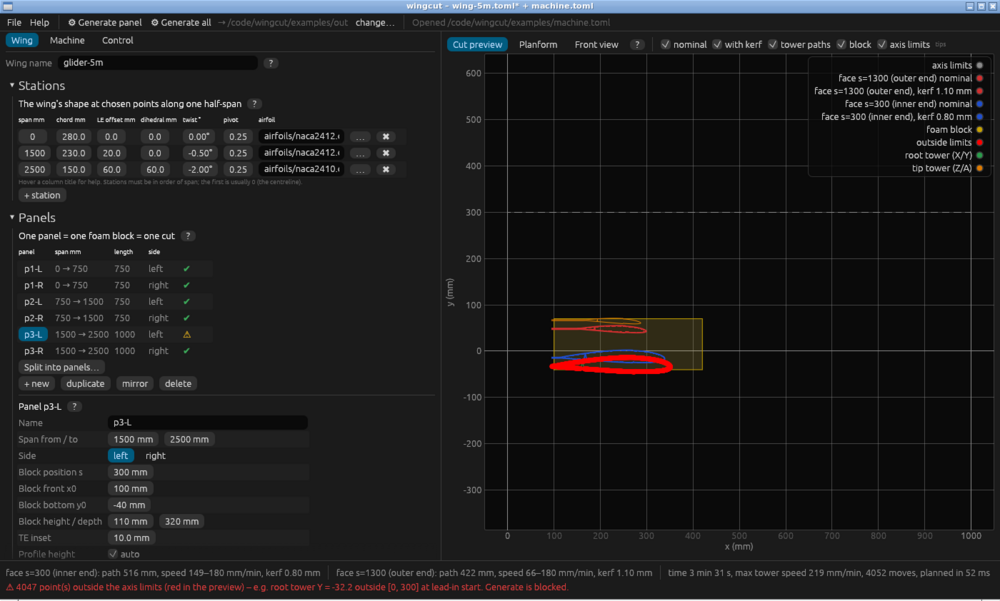

| message | meaning | what to do |
|---|---|---|
| *station at N is inside the panel* | the wire can only blend straight between the panel's ends, so the station's kink is lost | split the panel at that station (*Split into panels…*, at the stations) |
| *… profile does not fit inside the block* | the shape at one end sticks out of the block | bigger block (height/depth), move it, or less TE inset |
| *N points outside the axis limits* | the wire would leave the machine's travel; nothing can be generated | move the block (x0, y0, block position s), use a smaller block, or check the limits |
| *block faces … must lie between the towers* / *outside the towers* | the block sticks out past a tower | **centre between towers**, or a shorter panel |
| *longer than the tower spacing* | the panel can't fit on the machine | split it (*Split into panels…*) |
| *cutout … does not fit on the core* | the slot is too near the LE/TE, an LE block or TE stock | move it (x) or make it narrower |
| *cutout … goes through the section* | too deep for the foam there | less depth or more leave |
| *the sheeting … is thicker than the section* | skins thicker than the airfoil near the nose | thinner skin, or a larger chord |
| *slot … narrower than the kerf* | the wire is wider than the slot | accept a kerf-wide slit, or make it wider |
| *machine is Alarm: it must be Idle* | the board needs homing or unlocking | ⌂ Home (or Unlock) |
| *wire is not in front of the block* | the first move is vertical and would hit the foam | jog both towers towards you (◀ to front) |
| *the Riden supply is enabled but not connected* | wingcut can't set the current | Connect supply, or untick it |
| *wire current dropped …* | broken wire or lost contact during the cut | check the wire and clamps, then Resume or STOP |
| *connection lost …* | the USB/Wi-Fi link dropped mid-cut | the board finishes its buffered moves: use the E-stop if needed |

---

## Files

- **wing.toml**: the wing (name, stations, panels with their blocks, sheeting and cutouts). Plain text you can also edit by hand.
- **machine.toml**: the machine, including the connection and the Riden settings.
- **out/** `<panel>.gcode`: the program for one panel; `<panel>.svg`: a picture of the same cut, viewable in any browser.
- The command-line tool does the same as Generate: `wingcut gen --machine machine.toml --wing wing.toml -o out/`.

## Glossary

- **Chord**: airfoil length from leading to trailing edge.
- **Core**: the foam part, before the skin goes on.
- **D-box**: a stiff tube formed by the skin around the front of the wing and the spar.
- **Dihedral / polyhedral**: the wing tips higher than the root; *polyhedral* when the angle changes at joints.
- **Face**: one end of the foam block; each panel has an inner-end face and an outer-end face.
- **Kerf**: the width of foam melted away by the wire.
- **LE / TE**: leading edge (rounded front) / trailing edge (thin back).
- **Panel**: one foam block, cut in one go.
- **Planform**: the wing seen from above.
- **Ruled surface**: a surface made of straight lines between two curves; what a straight hot wire cuts.
- **Span / half-span**: wingspan / the distance from the centreline to one tip.
- **Station**: a place along the span where the wing is described.
- **Sweep**: leading edge moving back towards the tip.
- **Washout**: the tip twisted nose-down compared with the root, for gentle stalls.
